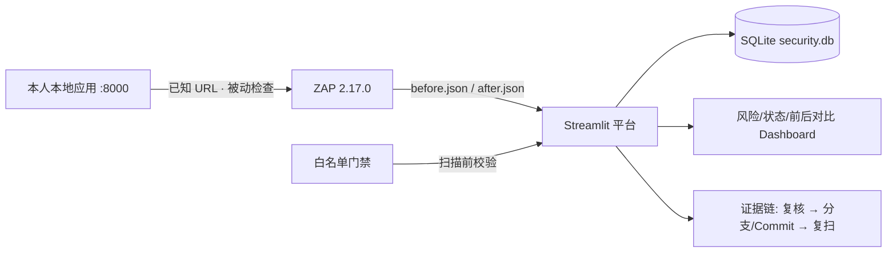

# 实验 07：软件安全检测与漏洞管理平台

基于 **OWASP ZAP 2.17.0** 被动扫描报告与 **Streamlit + SQLite** 的轻量漏洞管理平台：
授权门禁 → 报告导入 → 指纹去重 → 人工复核与指派 → 修复 Commit 关联 → before/after
复扫对比 → 证据链追踪与脱敏导出，形成“扫描-分类-修复-复扫”闭环。

- 课程：《开源软件与新技术》实验 07　课程编号 230518255
- 完成方式：个人独立完成
- 上游基线：OWASP ZAP（Apache-2.0）、Streamlit（Apache-2.0），见 [NOTICE.md](NOTICE.md)

> **法律与范围警告**：本平台仅用于本人本地、教师授权或专门靶场环境的被动检查。扫描前必须
> 通过白名单门禁；未授权公网资产一律不得扫描。扫描告警不等于安全结论，剩余风险如实展示，
> 不宣称应用已无漏洞。

## 1. 问题场景与功能清单

安全工具会产生大量告警，但软件安全工程需要把告警转化为可追踪的风险：确认授权范围、去重、
分级、指派负责人、关联修复 Commit，再复扫验证是否关闭。本平台对应功能：

| 要求（实验指导书） | 本仓库实现 |
| --- | --- |
| scope.md 含所有者、目标、时间、动作和批准 | 根目录 `scope.md` |
| 扫描前白名单强制校验目标 | `core/gate.py` + 平台「授权范围门禁」页 |
| 导入、显示和筛选告警 | `core/parser.py` + 「漏洞复核与处置」页筛选 |
| 重复导入按稳定指纹去重 | `core/fingerprint.py` + `core/importer.py` |
| 负责人、状态、风险和处置理由可编辑 | 处置表单，7 种状态工作流 |
| 至少 1 个问题有修复 Commit 和测试 | 样本中 10020/10021/10038 关联 Commit 与复扫批次；回归测试 3 项 |
| after 同等配置并显示对比 | `core/compare.py`：新增/未变/已关闭/风险变化 |
| Verified 有复扫/人工验证证据 | 无 Commit 或无复扫批次时拒绝置 Verified |
| 报告脱敏、未扫描未授权公网资产 | `core/exporter.py` 正则脱敏 + 门禁拒绝公网 |

## 2. 技术栈与架构

| 组件 | 版本 | 用途 |
| --- | --- | --- |
| Python | 3.13.x | 平台运行时 |
| Streamlit | 1.67.0 | Web 界面与 Dashboard |
| pandas | 3.1.1 | 表格与图表数据 |
| SQLite | 标准库 sqlite3 | 批次 / Finding / 实例 / 复核记录 |
| pytest | 9.2.0 | 范围、解析、工作流、回归、复扫测试 |
| ZAP | 2.17.0（被动规则） | 上游扫描工具，产出 Traditional JSON |



## 3. 环境要求与版本检查

```powershell
python --version          # 3.13.x
git --version             # 2.40+（提交证据用）
python -m pip --version
```

依赖版本固定在 `requirements.txt`，不写“最新版”。

## 4. 目录结构

```
management-platform/
├── core/                     # 平台本人实现代码
│   ├── config.py             # 白名单、状态、风险等级、规则说明
│   ├── gate.py               # 扫描前目标白名单门禁
│   ├── parser.py             # ZAP Traditional JSON 解析与 HTML 净化
│   ├── fingerprint.py        # 稳定指纹算法
│   ├── db.py                 # SQLite 表结构与访问层
│   ├── importer.py           # 报告导入、去重归并、出现历史留存
│   ├── compare.py            # before/after 批次对比
│   ├── exporter.py           # 脱敏导出 CSV/JSON
│   ├── evidence.py           # 复核记录与报告哈希证据导出
│   ├── seed.py               # 演示样本初始化
│   └── app.py                # Streamlit 主界面
├── web/target_app.py         # 本地被测示例（可开关安全响应头）
├── data/samples/             # 脱敏 before/after 样本 JSON
├── scripts/                   # 启动、停止、测试、重置脚本
├── tests/                     # pytest：门禁/解析去重/工作流/回归/复扫
├── docs/                      # 授权、架构、指纹、测试、Git、思考题、演示、限制
│   └── evidence/             # 测试与复核证据原件
├── scope.md                  # 书面授权范围记录
├── requirements.txt
├── NOTICE.md
└── README.md
```

## 5. 安装、初始化、运行与停止

```powershell
# 0) 进入项目目录
cd D:\management-platform

# 1) 一键启动（自动建 .venv、装依赖、初始化演示库、启动平台）
powershell -ExecutionPolicy Bypass -File scripts\start-platform.ps1
```

访问：<http://127.0.0.1:8501>

```powershell
# 停止平台
powershell -ExecutionPolicy Bypass -File scripts\stop-platform.ps1

# 重置演示数据（清空数据库，重新导入样本与复核记录）
powershell -ExecutionPolicy Bypass -File scripts\seed-demo.ps1
```

手动等价步骤：

```powershell
python -m venv .venv
.venv\Scripts\python -m pip install -r requirements.txt
.venv\Scripts\python -m core.seed
.venv\Scripts\python -m streamlit run core\app.py --server.port 8501
```

## 6. 最小演示数据与 Demo 流程

内置两份脱敏样本：`data/samples/zap-before.json`（5 条规则、6 个实例）、
`data/samples/zap-after.json`（2 条未变规则）。初始化后：

1. **概览**：查看风险分布、状态分布与前后对比概览；
2. **授权范围门禁**：查看 scope.md 与白名单；输入公网地址演示被拒绝；
3. **报告导入**：可重复导入样本，验证重复导入不新建 Finding；
4. **漏洞复核与处置**：按状态/风险/负责人筛选，查看实例证据、复核记录，编辑处置信息；
5. **复扫对比**：选择 before/after 批次，查看已关闭 / 未变 / 新增 / 风险变化；
6. **证据链追踪**：查看单条 Finding 从首次发现到 Verified 的完整时间线；
7. **导出与说明**：下载脱敏 CSV / JSON。

样本闭环：10020（缺 X-Frame-Options）、10021（缺 X-Content-Type-Options）、
10038（缺 CSP）复核为真阳性，修复安全响应头后经 after 复扫关闭（Verified）；
10035（HSTS）判为接受风险（本机 HTTP，HSTS 仅适用 HTTPS）；10096（Banner 信息）判为误报。

## 7. 测试

```powershell
powershell -ExecutionPolicy Bypass -File scripts\run-tests.ps1
```

| 测试层 | 数量 | 重点 |
| --- | --- | --- |
| 范围安全 | 8 | 白名单、协议、私网/公网、重定向越界 |
| 解析/去重 | 8 | 缺字段、多实例、HTML 净化、重复导入、易变参数、误合并反例 |
| 工作流 | 6 | 状态、负责人、理由、Verified 证据约束 |
| 修复回归 | 3 | 安全头出现/缺失、页面功能不退化 |
| 复扫对比 | 2 | 新增/未变/关闭分类、风险变化 |

证据原件：`docs/evidence/test-run.txt`、`review-log.txt`、`before-after-hash.txt`。

## 8. 已知问题与限制

见 [docs/08-未做与限制.md](docs/08-未做与限制.md)。要点：单机无鉴权、被动检测边界、
样本为脱敏演示数据、不宣称无漏洞、Docker/DefectDojo/Juice Shop 未实跑、SQLite 单文件。

## 9. 二次开发内容（与上游基线差异）

上游 ZAP 提供规则判定与报告导出；上游 Streamlit 提供界面组件。本人实现：

- 白名单门禁与越界拒绝记录；
- Traditional JSON 三级结构（site→alerts→instances）解析与 HTML 净化；
- 规则 ID + 规范化 origin/方法/路径/参数名的稳定指纹与跨批次去重；
- 7 状态漏洞工作流、负责人/分支/Commit/复扫批次关联与 Verified 证据约束；
- before/after 按指纹对比与 Dashboard 图表；
- 脱敏导出与复核/哈希证据落盘。

## 10. 个人开发记录与贡献证据

- Git 分支、Commit 与 PR 记录见 `docs/05-Git与开源规范.md`；
- 复核记录与覆盖说明：`docs/evidence/review-log.txt`；
- 前后报告哈希与覆盖范围：`docs/evidence/before-after-hash.txt`；
- 测试运行结果：`docs/evidence/test-run.txt`。

## 11. 安全注意事项与敏感配置

- 平台只监听 127.0.0.1；ZAP 代理/API 不向公网开放，API Key 由服务端持有；
- 导出前自动脱敏 Token、Cookie、口令、JWT，仍需人工复核；
- 原始报告限制在本机/教师可访问位置，不随公开仓库提交；
- 演示结束后轮换临时 Token、清理测试账号；数据库文件已在 `.gitignore` 中排除；
- 紧急停止方法见 `scope.md` 第 5 节。

## 12. 主要功能截图

截图占位与采集清单见 [docs/07-演示脚本.md](docs/07-演示脚本.md) 第 3 节（S1–S7），
对应 PPT 占位页；课堂展示无需现场运行系统，截图与证据原件可直接核对。
